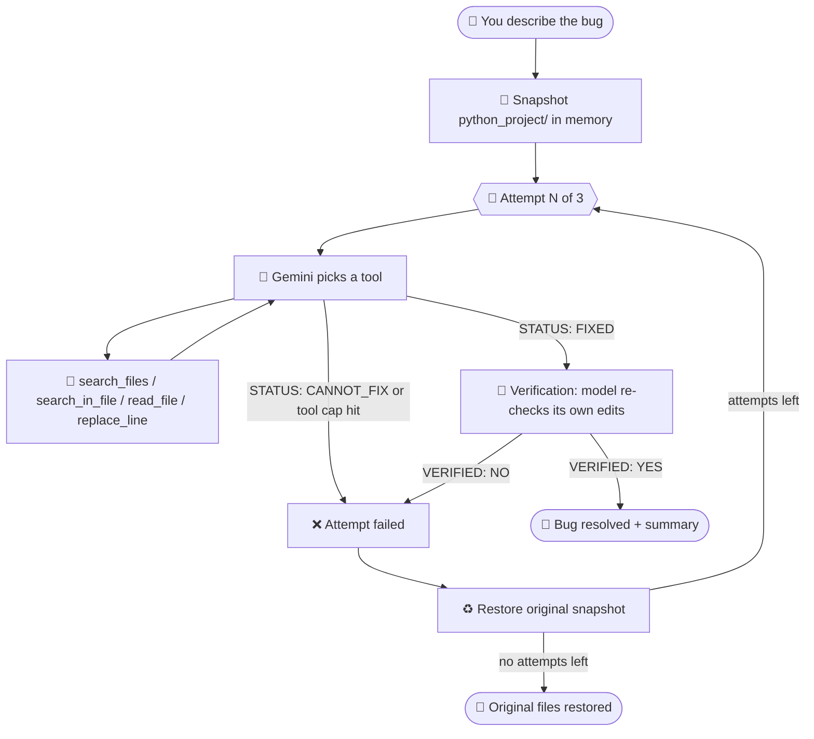

<div align="center">


<p>
  <a href="https://www.python.org/"></a>
  <a href="https://ai.google.dev/"></a>
  <a href="https://docs.astral.sh/uv/"></a>
  
</p>

<p>
  
  
  
  
</p>

<p>
  
</p>

<h3>🐍 A simple, transparent, CLI-based autonomous coding agent 🤖</h3>

</div>

---

## ✨ What is this?

You tell the agent, in plain English, what is wrong with your code, for example *"add() gives the wrong answer"*. It then **searches, reads, reasons about, and edits your Python code** until the bug is fixed, printing **every single step** it takes along the way.

There is **no LangChain, no LangGraph, no CrewAI, no ADK, no AutoGen**. The whole agent is a plain, readable Python loop, so you can see exactly what happens at every step.

> 🧠 **Static reasoning only.** The model gets *no shell, no interpreter, and no code execution*. It finds bugs purely by reading your code, like a human reviewer.

---

## 🚀 Features

| | Feature | Description |
|---|---|---|
| 🔍 | **Smart code search** | Finds files and lines by keyword, with exact 1-based line numbers and 3 lines of context |
| ✏️ | **Surgical edits** | Replaces **one line at a time** and keeps your indentation. It never rewrites whole files |
| 🪵 | **Fully transparent** | Every tool call, argument, and `Before` / `After` line is printed to your terminal |
| ✅ | **Self-verification** | After a fix, the model re-reads its own edits and must confirm them before the attempt counts as a success |
| 🔁 | **3 attempts max** | Each retry starts from a clean snapshot and carries a note about what failed before |
| 🛟 | **Automatic rollback** | If all 3 attempts fail, every file is restored **byte-for-byte** to the original |
| 🧱 | **Hard safety caps** | Limited tool calls per attempt, so it can never loop forever |
| 🔄 | **Model fallback** | Retries on temporary API errors and can switch to a backup model |
| 🔒 | **Sandboxed** | The agent can only touch files inside `python_project/` |

---

## 🧩 How it works



---

## 🛠️ The four tools the AI can use

| Tool | What it does |
|---|---|
| 🔎 `search_files(query)` | Lists workspace files whose name or contents match any keyword |
| 🎯 `search_in_file(file_path, keyword)` | Case-insensitive search that returns matching lines, **1-based line numbers**, and ±3 lines of context |
| 📖 `read_file(file_path)` | Returns the whole file with line numbers (`1: ...`, `2: ...`) |
| ✏️ `replace_line(file_path, line_number, new_line)` | Replaces **only** that one line and preserves its indentation |

---

## 📁 Project structure

```text
coding-agent/
├── 📄 main.py            # CLI entry point: asks for the bug, starts the agent
├── 🧠 agent.py           # The manual tool-calling loop, retries, verification, rollback
├── 🧰 tools.py           # The 4 tools + snapshot/restore + Gemini declarations
├── 📦 pyproject.toml     # Python 3.11+ and dependencies (managed by uv)
├── 🔑 .env.example       # Template for your API key and model settings
├── 🙈 .gitignore         # Keeps secrets and caches out of Git
├── 📘 README.md          # You are here!
└── 🐍 python_project/
    └── main.py           # Sample code: you introduce the bug here
```

---

## ⚡ Quick start

### 1️⃣ Install [uv](https://docs.astral.sh/uv/)

```bash
# macOS / Linux
curl -LsSf https://astral.sh/uv/install.sh | sh

# Windows (PowerShell)
powershell -ExecutionPolicy ByPass -c "irm https://astral.sh/uv/install.ps1 | iex"
```

### 2️⃣ Add your Gemini API key

```bash
cp .env.example .env
```

Then open `.env` and fill it in:

```env
GEMINI_API_KEY=your-api-key-here
GEMINI_MODEL=gemini-3.5-flash-lite
# GEMINI_FALLBACK_MODEL=   # optional backup model
```

> 🔑 Get a free key from [Google AI Studio](https://aistudio.google.com/apikey).

### 3️⃣ Introduce a bug 😈

Open `python_project/main.py` and break something. For example, change this:

```python
def add(a, b):
    return a + b
```

into this:

```python
def add(a, b):
    return a - b
```

### 4️⃣ Run the agent

```bash
uv run main.py
```

---

## 🖥️ Example session

```text
Describe the bug in simple English: add() returns the wrong result, it seems to subtract
[Model] gemini-3.5-flash-lite

--- Attempt 1 of 3 ---
[Tool Called] search_files(query="add")
    -> ok: ["main.py"]
[Tool Called] search_in_file(file_path="main.py", keyword="def add")
    -> ok: [{"line_number": 1, "line": "def add(a, b):", ...}]
[Tool Called] replace_line(file_path="main.py", line_number=2, new_line="return a + b")
    Before (main.py:2):     return a - b
    After  (main.py:2):     return a + b
[Verification] Asking the model to re-check its own edits ...
[Verification] YES: The function now returns the sum as intended.

=== Bug resolved ===
Line 2 of main.py was changed from `return a - b` to `return a + b`,
because add() must return the sum of its arguments, not the difference.
```

And if the agent can't solve it:

```text
I cannot solve this bug within the 3-attempt limit. Original files have been restored.
```

---

## ⚙️ Configuration

| Variable | Required | Default | Purpose |
|---|---|---|---|
| `GEMINI_API_KEY` | ✅ | n/a | Your Google Gemini API key |
| `GEMINI_MODEL` | ❌ | `gemini-3.5-flash-lite` | Primary model to use |
| `GEMINI_FALLBACK_MODEL` | ❌ | *(none)* | Used automatically if the primary returns 404/429/500/503 after retries |

Limits you can tune at the top of `agent.py`:

| Constant | Default | Meaning |
|---|---|---|
| `MAX_ATTEMPTS` | `3` | Resolution attempts before giving up |
| `MAX_FIX_TOOL_CALLS` | `15` | Tool calls allowed while fixing, per attempt |
| `MAX_VERIFY_TOOL_CALLS` | `5` | Extra tool calls allowed while verifying, per attempt |

---

## 🛡️ Safety by design

- 🧪 **No code execution**: the model never gets a shell or interpreter.
- 📦 **Sandboxed paths**: file access can't escape `python_project/`.
- ✂️ **One line at a time**: edits are small, visible, and easy to review.
- 📸 **Snapshot and rollback**: the original files are restored after failure, errors, or <kbd>Ctrl</kbd> + <kbd>C</kbd>.
- ♾️ **No infinite loops**: strict caps on attempts and tool calls.

---

## 💡 Tips for best results

- ✍️ **Be specific.** *"factorial(5) returns 24 instead of 120"* works better than *"something is broken"*.
- 🐛 **One bug at a time.** The agent is tuned for a single logical bug.
- 🔎 **Mention the function name** if you know it. It makes searching faster.

---

## 🧱 Built with

<p>
  
  
  
  
</p>

---

<div align="center">

### ⭐ If this helped you, give it a star! ⭐


</div>
